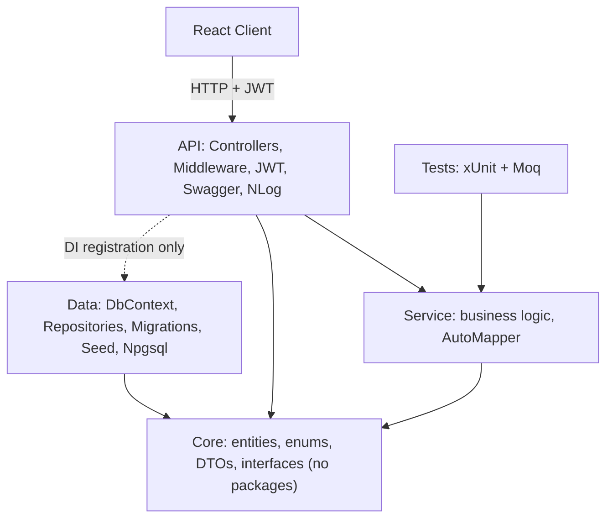
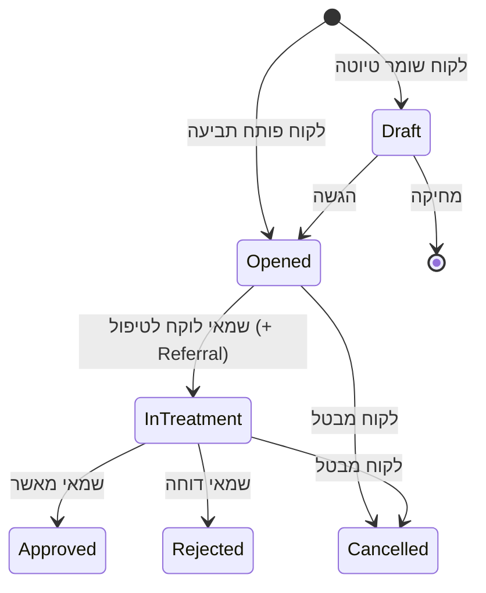

# Insurance Claims API – ניהול תביעות ביטוח

שרת ASP.NET Core (.NET 10) לניהול תביעות ביטוח מול PostgreSQL. לקוחות פותחים תביעות, שמאים לוקחים אותן לטיפול, והמערכת מבטיחה שכל תביעה תגיע **לשמאי אחד בלבד**, גם כששני שמאים לוחצים "קח לטיפול" באותו רגע.

הלקוח (React) נמצא במאגר נפרד, `InsuranceComClient`, ופרוס כאתר נפרד. כדי שהדפדפן יוכל לפנות לשרת יש להגדיר את כתובת הלקוח ב-`Cors:AllowedOrigins` (משתנה סביבה `Cors__AllowedOrigins`, כמה כתובות מופרדות בפסיק).

## תיאור המערכת

| ישות | תיאור |
|------|-------|
| `Client` | לקוח (משתמש בתפקיד Client): שם, אימייל, סיסמה מוצפנת, טלפון, כתובת, מספר זיהוי. |
| `Employee` | עובד: `Manager` או `Appraiser`. שמאי מתמחה בסוגי ביטוח (many-to-many). |
| `InsuranceType` | סוג ביטוח (רכב, דירה, בריאות). הלקוח מחזיק בסוגי ביטוח (many-to-many). |
| `Claim` | תביעה, המשאב שמתחרים עליו. כוללת `Version` לבקרת תחרות. |
| `Referral` | הפניית תביעה לשמאי. נוצרת אוטומטית בלקיחה לטיפול. |

| תפקיד | מה מותר |
|-------|---------|
| Client | פתיחת תביעה, צפייה בתביעות שלו בלבד, ביטול, עדכון פרטיו, מחיקת טיוטות |
| Manager | ניהול סוגי ביטוח, צפייה בכל התביעות (ללא טיוטות) וברשימת הלקוחות, יצירה ומחיקה של עובדים. לא פותח ולא מוחק תביעות |
| Appraiser | צפייה בתביעות ובהפניות שלו, פרטי קשר של לקוחות עם תביעה בטיפול אצלו, לקיחת תביעה, אישור או דחייה של תביעה שלו |

כללים עסקיים (בשכבת ה-Service): תביעה נפתחת רק על סוג ביטוח שהלקוח מחזיק בו; לקוח מוחק רק טיוטה ומבטל רק תביעה שטרם אושרה או נדחתה; שמאי לוקח רק תביעה מתחום ההתמחות שלו; מספר הזיהוי של לקוח לא נחשף לשמאי.

## ארכיטקטורה



## זרימת תביעה



## התביעה כמשאב מוגבל – טיפול בתחרות

1. ל-`Claim` יש `Version` (Guid) עם `[ConcurrencyCheck]`.
2. `AppDbContext.SaveChangesAsync` נדרס ומחליף את `Version` בכל תביעה שהשתנתה.
3. EF מוסיף ל-`UPDATE` את התנאי `WHERE Id = @id AND Version = @oldVersion`. השמירה השנייה לא מוצאת שורה ו-EF זורק `DbUpdateConcurrencyException`.
4. `UnitOfWork` תופס **רק** חריגה זו ומתרגם ל-`ConcurrencyConflictException` (כך ה-Service לא תלוי ב-EF).
5. `ClaimService.TakeAsync` בודק סטטוס, התמחות וגרסה, מעדכן את התביעה ויוצר את ה-Referral **באותה שמירה**, ולכן מי שמפסיד לא משאיר אחריו הפניה. התנגשות נרשמת כ-Warning.
6. ה-Controller מחזיר **409** עם "התביעה נלקחה לטיפול על ידי עובד אחר".

לקיחה לטיפול: `PUT /api/claims/{id}/handler` עם `{ "version": "..." }`. ביטול: `PUT /api/claims/{id}/status`.

## Endpoints

| משאב | נתיבים |
|------|--------|
| auth | `POST /api/auth/register` (לקוח), `POST /api/auth/login` |
| claims | `GET`, `GET {id}`, `POST`, `PUT {id}` (טיוטה), `PUT {id}/handler`, `PUT {id}/status`, `DELETE {id}` (טיוטה) |
| clients | `GET`, `GET {id}`, `PUT {id}`, `PUT {id}/insurance-types` |
| referrals | `GET`, `GET {id}`, `PUT {id}` |
| employees | `GET`, `GET {id}`, `POST`, `DELETE {id}` |
| insurance-types | `GET`, `GET {id}`, `POST`, `PUT {id}`, `DELETE {id}` |

סטטוסים: 200, 201 (עם Location), 204, 400, 401, 403, 404, 409. Swagger ב-`/swagger` כולל כפתור Authorize להזנת Token.

## למה Singleton שמחזיק Scoped הוא באג

`DbContext`, ה-Repositories וה-Services רשומים כ-**Scoped** (מופע לכל בקשה). Singleton חי לאורך כל חיי האפליקציה, ולכן Singleton שמקבל Scoped בבנאי "תופס" את ה-`DbContext` של הבקשה הראשונה לנצח: הוא ישותף בין תהליכונים (`DbContext` אינו thread-safe), יחזיק נתונים ישנים במעקב, ויישאר בשימוש גם אחרי שנסגר. ב-`Program.cs` מופעל `ValidateScopes` ו-`ValidateOnBuild`, כך שטעות כזו נכשלת כבר בעליית האפליקציה.

## הרצה מקומית

דרוש PostgreSQL. הדרך הקלה: `docker compose up -d db` מתיקיית המאגר (משתמש `insurance`, סיסמה `insurance_dev_password`, בסיס `insurance_claims`).

```bash
dotnet user-secrets set "ConnectionStrings:DefaultConnection" "Host=localhost;Port=5432;Database=insurance_claims;Username=insurance;Password=insurance_dev_password" --project src/InsuranceClaims.API
dotnet user-secrets set "Jwt:Key" "<מחרוזת אקראית של לפחות 32 תווים>" --project src/InsuranceClaims.API
dotnet run --project src/InsuranceClaims.API
```

השרת עולה ב-`http://localhost:5080`. ה-Migrations וה-Seed מופעלים אוטומטית בעלייה (`Database:MigrateOnStartup`), ללא התערבות ידנית.

## משתמשי דמו

| תפקיד | אימייל | סיסמה |
|-------|--------|-------|
| מנהל | manager@example.com | Manager123! |
| שמאי 1 (רכב, דירה) | appraiser1@example.com | Appraiser123! |
| שמאי 2 (רכב, בריאות) | appraiser2@example.com | Appraiser123! |
| לקוח 1 (רכב, דירה) | client1@example.com | Client123! |
| לקוח 2 (רכב, בריאות) | client2@example.com | Client123! |

שני השמאים מתמחים ברכב, ולכן מתחרים על תביעות רכב פתוחות (CLM-0001, CLM-0005).

## בדיקות

```bash
dotnet test
```

בדיקת התחרות והבדיקות מול בסיס נתונים רצות רק כשמוגדר בסיס נתונים נפרד שהשם שלו מכיל `test` (הוא נמחק ונבנה מחדש):

```bash
INSURANCE_CLAIMS_TEST_DB="Host=localhost;Port=5432;Database=insurance_test;Username=insurance;Password=insurance_dev_password" dotnet test
```

## לוגים

NLog מאחורי `ILogger`: שורה לכל בקשה עם CorrelationId, Error לכל חריגה, Warning להתנגשות על תביעה, Information להרשמה וליצירת עובד (מזהה בלבד). אין בלוג סיסמאות, Tokens, Connection String, מספרי זיהוי או תוכן בקשות.

## מיפוי נושאי הקורס

| נושא | מיקום |
|------|-------|
| Web API, REST, Swagger | `API/Controllers`, `/swagger` |
| Model Binding ו-Validation | `Core/DTOs` (Data Annotations), `[FromQuery]` / Route / Body |
| ארכיטקטורה בשכבות | ארבעת הפרויקטים |
| Dependency Injection | `Program.cs`, `*/DependencyInjection.cs` |
| EF Core: DbContext, Migrations, Seed | `Data/AppDbContext.cs`, `Data/Migrations` (Init, AddClaimVersion), `Data/SeedData.cs` |
| EF Core: שאילתות וקשרים | `Data/Repositories`, `Data/Configurations` |
| DTO ו-AutoMapper | `Core/DTOs`, `Service/Mapping` |
| Async | `async` + `CancellationToken` מה-Controller עד ה-DbContext |
| Middleware | `API/Middleware` |
| Configuration | `appsettings*.json`, `IOptions<JwtSettings>`, User Secrets |
| JWT | `API/Extensions`, `API/Security`, `AuthService` |
| xUnit ו-Moq | `tests/InsuranceClaims.Tests` |
| תחרות על משאב | `ClaimService.TakeAsync`, `AppDbContext`, `ClaimConcurrencyTests` |
| NLog | `API/nlog.config` |

## Deploying to Render (free tier)

Two repositories, three free resources: a PostgreSQL database and a Docker web service (this repo, `render.yaml`), and a static site (`InsuranceComClient`).

**Free-tier limits to know about**
- The free PostgreSQL database **expires 30 days after creation** (14-day grace period, then it is deleted), is limited to 1 GB, and only one per workspace. Back up or recreate it before it expires.
- The free web service **sleeps after 15 minutes without traffic**; the first request afterwards takes about a minute. It has 512 MB RAM and 750 free instance hours per month.
- Never upgrade a resource's plan unless you intend to pay.

**Steps**
1. Render Dashboard -> New -> Blueprint -> connect `InsuranceComServer` -> review that every resource says `Free` -> Apply.
   This creates `insurance-db` and `insurance-claims-api`. `ConnectionStrings__DefaultConnection` comes from the database and `Jwt__Key` is generated by Render; neither is stored in git.
2. Deploy the client (see the `InsuranceComClient` README) with `VITE_API_URL` = the API's public URL.
3. On the API service -> Environment, set `Cors__AllowedOrigins` to the client's URL (for example `https://insurance-claims-client.onrender.com`, no trailing slash) and save; the service redeploys.
4. Both services auto-deploy on every push to `main`.

**Environment variables (API)**

| Variable | Source | Purpose |
|---|---|---|
| `ConnectionStrings__DefaultConnection` | from the database (Blueprint) | PostgreSQL; `postgres://` URLs are converted automatically, SSL required |
| `Jwt__Key` | generated by Render | JWT signing key |
| `Cors__AllowedOrigins` | set manually | comma-separated client origin(s) |
| `PORT` | set by Render | port the app listens on |
| `Database__MigrateOnStartup` | default `true` | applies EF Core migrations (and seed data) at startup |
| `Swagger__Enabled` | default `false` | `true` exposes `/swagger` in Production |

**Verify**: `GET /health` returns `Healthy`; the logs show the migrations being applied; log in from the client with a demo user.

**Troubleshooting**
- Client shows network/CORS errors: `Cors__AllowedOrigins` must match the client origin exactly (scheme + host, no trailing slash).
- Client calls the wrong host: `VITE_API_URL` is baked in at build time; change it and redeploy the client.
- API exits at startup with "Connection string ... is missing": the database link is not set on the service.
- First request is very slow or times out: the free service was asleep; retry after a minute.
- Database connection errors after ~30 days: the free database expired.
- Local check before pushing: `docker compose up --build`, then `http://localhost:8080/health`.
